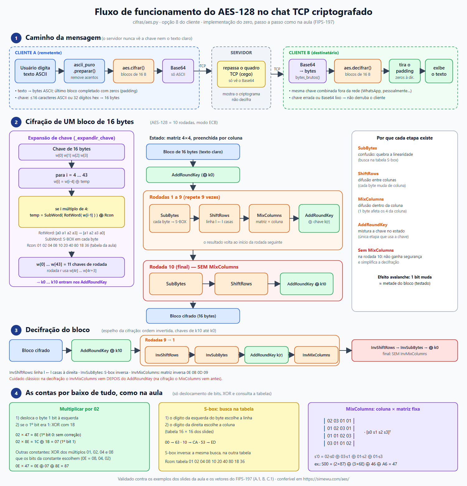

# AES-128 (Advanced Encryption Standard) — Guia de Estudo

> Guia da cifra `cifras/aes.py` (opção **8** do menu do cliente). Segue o FIPS-197 e,
> passo a passo, os slides da aula (`AULA AES.pdf`), sem biblioteca de criptografia:
> o SubBytes é uma **busca na tabela S-box**, a multiplicação do MixColumns usa só
> **deslocamento de bits e XOR** e o Rcon é uma **tabela** — as mesmas contas feitas em sala.

## Índice

1. [Visão geral](#1-visão-geral)
2. [O estado 4×4](#2-o-estado-44)
3. [Multiplicação de bytes (campo de Galois)](#3-multiplicação-de-bytes-campo-de-galois)
4. [S-BOX (tabela)](#4-s-box-tabela)
5. [Expansão de chave (w[0]..w[43]) e Rcon](#5-expansão-de-chave-w0w43-e-rcon)
6. [As operações da rodada](#6-as-operações-da-rodada)
7. [Cifração e a rodada final](#7-cifração-e-a-rodada-final)
8. [Decifração](#8-decifração)
9. [Uso no chat](#9-uso-no-chat)
10. [Como testar](#10-como-testar)
11. [Erros comuns](#11-erros-comuns-cobertos-pelos-testes)

---



*Fluxo completo: caminho da mensagem no chat, cifração e decifração de um bloco e as contas de multiplicação e S-box feitas na aula. Versão vetorial: [aes-fluxo.svg](docs/imagens/aes-fluxo.svg).*

---

## 1. Visão geral

| Parâmetro | AES-128 |
|---|---|
| Bloco | 128 bits = **16 bytes** |
| Chave | 128 bits = **16 bytes** |
| Rodadas | **10** |
| Chaves de rodada | 11 (`w[0]..w[43]`, 4 palavras de 4 bytes cada) |

Ao contrário do DES (rede de Feistel, que transforma só metade do bloco por rodada), o AES
é uma rede de **substituição-permutação**: todos os 16 bytes mudam em toda rodada.

```
AddRoundKey(chave 0)
rodadas 1..9 :  SubBytes → ShiftRows → MixColumns → AddRoundKey
rodada 10    :  SubBytes → ShiftRows →              AddRoundKey     (sem MixColumns!)
```

## 2. O estado 4×4

Os 16 bytes entram na matriz **por coluna** (`estado[linha][coluna] = bloco[linha + 4·coluna]`):

```
bytes b0 b1 ... b15           b0  b4  b8  b12
                      ──►     b1  b5  b9  b13
                              b2  b6  b10 b14
                              b3  b7  b11 b15
```

Cada coluna é uma palavra `w` de 4 bytes. Funções: `_bytes_para_estado`, `_estado_para_bytes`.

## 3. Multiplicação de bytes (campo de Galois)

O MixColumns e o InvMixColumns multiplicam bytes por constantes de uma matriz fixa. Nesse
"campo de Galois" **GF(2⁸)** (como nos slides):

- **Soma = XOR** bit a bit.
- **Multiplicação** = só deslocamento de bits e XOR, como mostrado a seguir.

### Multiplicar por 02 — `_multiplicar_por_2`

Desloca o byte 1 bit à esquerda. Se o **primeiro bit do byte original** era 1, descarta o 9º bit
e faz XOR com `1B` (`0001 1011`):

```
02 × 47   0100 0111 → 1000 1110 = 8E                          (primeiro bit 0: sem correção)
02 × 8E   1000 1110 → 1 0001 1100 → 1C;  1C XOR 1B = 07       (primeiro bit 1: com correção)
```

### Multiplicar por 03 e pelas constantes do InvMixColumns — `_multiplicar`

Calculam-se os múltiplos `01`, `02`, `04` e `08` do byte (cada um é o anterior × 02) e faz-se XOR
só dos múltiplos que **os bits ligados da constante** escolhem:

| Constante | Em binário | Parcelas que entram no XOR |
|---|---|---|
| `03` | 0000 0011 | múltiplo por 02 e o byte original (`03 × B = (02 × B) XOR B`) |
| `0E` | 0000 1110 | múltiplos por 08, 04 e 02 |
| `0B` | 0000 1011 | múltiplos por 08 e 02, mais o byte original |
| `0D` | 0000 1101 | múltiplos por 08 e 04, mais o byte original |
| `09` | 0000 1001 | múltiplo por 08, mais o byte original |

Exemplos dos slides:

```
03 × 6E = (6E << 1) XOR 6E = DC XOR 6E = B2

02 × 47 = 8E     04 × 47 = 07     08 × 47 = 0E            (cada um reaproveita o anterior)
0E × 47 = 08×47 XOR 04×47 XOR 02×47 = 0E XOR 07 XOR 8E = 87
```

## 4. S-BOX (tabela)

O SubBytes troca cada byte do estado pelo valor da **tabela S-box** (`SBOX`, a tabela 16×16 dos
slides): o dígito hexadecimal da **esquerda** do byte escolhe a **linha** (`x`) e o da **direita**
escolhe a **coluna** (`y`). Exemplo: o byte `53` → linha 5, coluna 3 → `ED`.

`_substituir_byte(byte, tabela)` faz essa busca. O InvSubBytes faz a mesma busca na **S-BOX inversa**
(`SBOX_INV`): `ED` → linha E, coluna D → `53`.

| x \ y | 0 | 1 | 2 | 3 | 4 | 5 | 6 | 7 | 8 | 9 | A | B | C | D | E | F |
|---|---|---|---|---|---|---|---|---|---|---|---|---|---|---|---|---|
| **0** | 63 | 7C | 77 | 7B | F2 | 6B | 6F | C5 | 30 | 01 | 67 | 2B | FE | D7 | AB | 76 |
| **1** | CA | 82 | C9 | 7D | FA | 59 | 47 | F0 | AD | D4 | A2 | AF | 9C | A4 | 72 | C0 |
| **2** | B7 | FD | 93 | 26 | 36 | 3F | F7 | CC | 34 | A5 | E5 | F1 | 71 | D8 | 31 | 15 |
| **3** | 04 | C7 | 23 | C3 | 18 | 96 | 05 | 9A | 07 | 12 | 80 | E2 | EB | 27 | B2 | 75 |
| **4** | 09 | 83 | 2C | 1A | 1B | 6E | 5A | A0 | 52 | 3B | D6 | B3 | 29 | E3 | 2F | 84 |
| **5** | 53 | D1 | 00 | ED | 20 | FC | B1 | 5B | 6A | CB | BE | 39 | 4A | 4C | 58 | CF |
| **6** | D0 | EF | AA | FB | 43 | 4D | 33 | 85 | 45 | F9 | 02 | 7F | 50 | 3C | 9F | A8 |
| **7** | 51 | A3 | 40 | 8F | 92 | 9D | 38 | F5 | BC | B6 | DA | 21 | 10 | FF | F3 | D2 |
| **8** | CD | 0C | 13 | EC | 5F | 97 | 44 | 17 | C4 | A7 | 7E | 3D | 64 | 5D | 19 | 73 |
| **9** | 60 | 81 | 4F | DC | 22 | 2A | 90 | 88 | 46 | EE | B8 | 14 | DE | 5E | 0B | DB |
| **A** | E0 | 32 | 3A | 0A | 49 | 06 | 24 | 5C | C2 | D3 | AC | 62 | 91 | 95 | E4 | 79 |
| **B** | E7 | C8 | 37 | 6D | 8D | D5 | 4E | A9 | 6C | 56 | F4 | EA | 65 | 7A | AE | 08 |
| **C** | BA | 78 | 25 | 2E | 1C | A6 | B4 | C6 | E8 | DD | 74 | 1F | 4B | BD | 8B | 8A |
| **D** | 70 | 3E | B5 | 66 | 48 | 03 | F6 | 0E | 61 | 35 | 57 | B9 | 86 | C1 | 1D | 9E |
| **E** | E1 | F8 | 98 | 11 | 69 | D9 | 8E | 94 | 9B | 1E | 87 | E9 | CE | 55 | 28 | DF |
| **F** | 8C | A1 | 89 | 0D | BF | E6 | 42 | 68 | 41 | 99 | 2D | 0F | B0 | 54 | BB | 16 |

<details>
<summary>S-BOX inversa (InvSubBytes)</summary>

| x \ y | 0 | 1 | 2 | 3 | 4 | 5 | 6 | 7 | 8 | 9 | A | B | C | D | E | F |
|---|---|---|---|---|---|---|---|---|---|---|---|---|---|---|---|---|
| **0** | 52 | 09 | 6A | D5 | 30 | 36 | A5 | 38 | BF | 40 | A3 | 9E | 81 | F3 | D7 | FB |
| **1** | 7C | E3 | 39 | 82 | 9B | 2F | FF | 87 | 34 | 8E | 43 | 44 | C4 | DE | E9 | CB |
| **2** | 54 | 7B | 94 | 32 | A6 | C2 | 23 | 3D | EE | 4C | 95 | 0B | 42 | FA | C3 | 4E |
| **3** | 08 | 2E | A1 | 66 | 28 | D9 | 24 | B2 | 76 | 5B | A2 | 49 | 6D | 8B | D1 | 25 |
| **4** | 72 | F8 | F6 | 64 | 86 | 68 | 98 | 16 | D4 | A4 | 5C | CC | 5D | 65 | B6 | 92 |
| **5** | 6C | 70 | 48 | 50 | FD | ED | B9 | DA | 5E | 15 | 46 | 57 | A7 | 8D | 9D | 84 |
| **6** | 90 | D8 | AB | 00 | 8C | BC | D3 | 0A | F7 | E4 | 58 | 05 | B8 | B3 | 45 | 06 |
| **7** | D0 | 2C | 1E | 8F | CA | 3F | 0F | 02 | C1 | AF | BD | 03 | 01 | 13 | 8A | 6B |
| **8** | 3A | 91 | 11 | 41 | 4F | 67 | DC | EA | 97 | F2 | CF | CE | F0 | B4 | E6 | 73 |
| **9** | 96 | AC | 74 | 22 | E7 | AD | 35 | 85 | E2 | F9 | 37 | E8 | 1C | 75 | DF | 6E |
| **A** | 47 | F1 | 1A | 71 | 1D | 29 | C5 | 89 | 6F | B7 | 62 | 0E | AA | 18 | BE | 1B |
| **B** | FC | 56 | 3E | 4B | C6 | D2 | 79 | 20 | 9A | DB | C0 | FE | 78 | CD | 5A | F4 |
| **C** | 1F | DD | A8 | 33 | 88 | 07 | C7 | 31 | B1 | 12 | 10 | 59 | 27 | 80 | EC | 5F |
| **D** | 60 | 51 | 7F | A9 | 19 | B5 | 4A | 0D | 2D | E5 | 7A | 9F | 93 | C9 | 9C | EF |
| **E** | A0 | E0 | 3B | 4D | AE | 2A | F5 | B0 | C8 | EB | BB | 3C | 83 | 53 | 99 | 61 |
| **F** | 17 | 2B | 04 | 7E | BA | 77 | D6 | 26 | E1 | 69 | 14 | 63 | 55 | 21 | 0C | 7D |

</details>

## 5. Expansão de chave (w[0]..w[43]) e Rcon

```
w[0..3]  = a chave (4 bytes por palavra)
para i = 4..43:
    temp = w[i-1]
    se i % 4 == 0:
        temp = SubWord(RotWord(temp)) ⊕ (Rcon[i/4], 0, 0, 0)
    w[i] = w[i-4] ⊕ temp
```

- **RotWord**: `[a0 a1 a2 a3] → [a1 a2 a3 a0]`
- **SubWord**: S-BOX em cada byte
- **Rcon**: tabela `01 02 04 08 10 20 40 80 1B 36` (rodadas 1 a 10), usada como a palavra
  `(Rcon, 00, 00, 00)` — só o primeiro byte do `SubWord(RotWord(...))` leva XOR com ela.

Exemplo dos slides, chave `0f 15 71 c9 | 47 d9 e8 59 | 0c b7 ad d6 | af 7f 67 98`:

```
i = 4:  temp = w[3] = af 7f 67 98      (4 mod 4 = 0)
        RotWord  → 7f 67 98 af
        SubWord  → d2 85 46 79         (S-BOX em cada byte)
        Rcon(1)  = 01 00 00 00 → d2 85 46 79 XOR 01 00 00 00 = d3 85 46 79
        w[4] = w[0] XOR temp = 0f 15 71 c9 XOR d3 85 46 79 = dc 90 37 b0
i = 5:  5 mod 4 ≠ 0  →  w[5] = w[1] XOR w[4] = 9b 49 df e9     (idem w[6] = 97 fe 72 3f, w[7] = 38 81 15 a7)
i = 8:  temp = w[7] = 38 81 15 a7 → RotWord 81 15 a7 38 → SubWord 0c 59 5c 07
        Rcon(2) = 02 00 00 00 → 0e 59 5c 07;   w[8] = w[4] XOR temp = d2 c9 6b b7
...     (a última chave de rodada é w[40..43] = b4 8e f3 52 | ba 98 13 4e | 7f 4d 59 20 | 86 26 18 76)
```

As palavras viram a matriz da chave **por colunas**: `w[0]` é a 1ª coluna (`0f 15 71 c9`).

Exemplo do FIPS-197 (A.1), chave `2b7e1516 28aed2a6 abf71588 09cf4f3c`, `i = 4`: `w[3] = 09cf4f3c` → RotWord `cf4f3c09` → SubWord `8a84eb01`
→ ⊕ Rcon `8b84eb01` → `w[4] = w[0] ⊕ 8b84eb01 = a0fafe17`.

Chaves de rodada para a chave do FIPS-197 (`2b7e1516 28aed2a6 abf71588 09cf4f3c`):

| Rodada | w[4r] w[4r+1] w[4r+2] w[4r+3] |
|---|---|
| 0 | 2b7e1516 28aed2a6 abf71588 09cf4f3c |
| 1 | a0fafe17 88542cb1 23a33939 2a6c7605 |
| 2 | f2c295f2 7a96b943 5935807a 7359f67f |
| 3 | 3d80477d 4716fe3e 1e237e44 6d7a883b |
| 4 | ef44a541 a8525b7f b671253b db0bad00 |
| 5 | d4d1c6f8 7c839d87 caf2b8bc 11f915bc |
| 6 | 6d88a37a 110b3efd dbf98641 ca0093fd |
| 7 | 4e54f70e 5f5fc9f3 84a64fb2 4ea6dc4f |
| 8 | ead27321 b58dbad2 312bf560 7f8d292f |
| 9 | ac7766f3 19fadc21 28d12941 575c006e |
| 10 | d014f9a8 c9ee2589 e13f0cc8 b6630ca6 |

## 6. As operações da rodada

- **SubBytes** — troca cada byte do estado pela S-BOX.
- **ShiftRows** — a linha `l` rotaciona `l` posições à **esquerda** (linha 0 fica parada).
- **MixColumns** — cada coluna é multiplicada pela matriz fixa abaixo; cada produto usa a
  multiplicação da seção 3 e as parcelas são somadas com XOR:

```
| s'0 |   | 02 03 01 01 |   | s0 |      s'0 = 02·s0 ⊕ 03·s1 ⊕ 01·s2 ⊕ 01·s3
| s'1 | = | 01 02 03 01 | · | s1 |      s'1 = 01·s0 ⊕ 02·s1 ⊕ 03·s2 ⊕ 01·s3
| s'2 |   | 01 01 02 03 |   | s2 |      ...
| s'3 |   | 03 01 01 02 |   | s3 |
```

  Exemplo dos slides (coluna `87 6E 46 A6`):
  `S00 = (2·87) ⊕ (3·6E) ⊕ 46 ⊕ A6 = 15 ⊕ B2 ⊕ 46 ⊕ A6 = 47`.
  O estado inteiro dos slides fica
  `87 F2 4D 97 / 6E 4C 90 EC / 46 E7 4A C3 / A6 8C D8 95` → `47 40 A3 4C / 37 D4 70 9F / 94 E4 3A 42 / ED A5 A6 BC`.
  Exercício dos slides (coluna `8b 7f fc e4`, 3ª linha `01 01 02 03`):
  `8b ⊕ 7f ⊕ (2·fc) ⊕ (3·e4) = 8b ⊕ 7f ⊕ e3 ⊕ 37 = 20`.
  Outro exemplo: coluna `db 13 53 45` → `8e 4d a1 bc`.
- **AddRoundKey** — XOR do estado com a chave da rodada (coluna `c` = palavra `w[4r+c]`).

Ver `_multiplicar_coluna` em `cifras/aes.py`: cada produto é um `_multiplicar` explícito (seção 3).

## 7. Cifração e a rodada final

Exemplo do Apêndice B do FIPS-197 (texto `3243f6a8 885a308d 313198a2 e0370734`):

| Etapa | Estado |
|---|---|
| entrada | `3243f6a8885a308d313198a2e0370734` |
| AddRoundKey (chave 0) | `193de3bea0f4e22b9ac68d2ae9f84808` |
| rodada 1 — SubBytes | `d42711aee0bf98f1b8b45de51e415230` |
| rodada 1 — ShiftRows | `d4bf5d30e0b452aeb84111f11e2798e5` |
| rodada 1 — MixColumns | `046681e5e0cb199a48f8d37a2806264c` |
| rodada 1 — AddRoundKey | `a49c7ff2689f352b6b5bea43026a5049` |
| ... | |
| rodada 10 — SubBytes | `e9098972cb31075f3d327d94af2e2cb5` |
| rodada 10 — ShiftRows | `e9317db5cb322c723d2e895faf090794` |
| rodada 10 — AddRoundKey | `3925841d02dc09fbdc118597196a0b32` ← cifrado |

A **rodada 10 não tem MixColumns**. O motivo é que, depois da última rodada, o MixColumns
não acrescentaria segurança (um atacante o desfaria de graça) e só complicaria a simetria
da decifração.

Para ver tudo isso rodando, `_cifrar_bloco(bloco, w, rastro=[])` preenche `rastro`
com `(nome_da_etapa, estado_em_hex)`.

## 8. Decifração

Começa pelo texto cifrado e pela **última** chave de rodada, desfazendo na ordem inversa:

```
AddRoundKey(chave 10)
rodadas 9..1 :  InvShiftRows → InvSubBytes → AddRoundKey(r) → InvMixColumns
final        :  InvShiftRows → InvSubBytes → AddRoundKey(0)
```

- **InvShiftRows**: a linha `l` rotaciona `l` posições à **direita**.
- **InvSubBytes**: S-BOX inversa.
- **InvMixColumns**: matriz inversa `0E 0B 0D 09 / 09 0E 0B 0D / 0D 09 0E 0B / 0B 0D 09 0E`, com
  as constantes montadas pelos múltiplos 08, 04, 02 e 01 (seção 3). Exemplo dos slides, coluna
  `47 37 94 ED`: `S00 = (0E×47) ⊕ (0B×37) ⊕ (0D×94) ⊕ (09×ED) = 87 ⊕ FA ⊕ 3E ⊕ C4 = 87`; a coluna
  inteira volta a `87 6E 46 A6`.
- O `InvMixColumns` vem **depois** do `AddRoundKey` e não existe na etapa final.

## 9. Uso no chat

- Opção **8 — Cifra AES** no menu do cliente.
- **Chave**: até 16 caracteres ASCII (completada com zeros à direita) **ou** 32 dígitos
  hexadecimais, com ou sem espaços, ex.: `2b 7e 15 16 28 ae d2 a6 ab f7 15 88 09 cf 4f 3c`.
- O texto (ASCII) é dividido em blocos de 16 bytes, modo **ECB**, último bloco completado com zeros.
- O criptograma (bytes 0–255) trafega em **Base64** para respeitar a regra ASCII-only da rede.
  O servidor só repassa o Base64 e nunca vê a chave.

## 10. Como testar

```bash
python tests/test_aes.py
```

Os testes conferem os exemplos numéricos dos slides (multiplicações, S-box, MixColumns,
InvMixColumns e expansão de chave) e os vetores oficiais do FIPS-197.

Conferência manual no site da disciplina, **https://simewu.com/aes/**: AES-128, modo ECB,
chave e texto em hexadecimal. Para um texto ASCII `Atacar base nort` (16 bytes) com a chave hex
acima, o criptograma exibido em hexadecimal deve coincidir com os bytes do Base64 mostrados no chat.

## 11. Erros comuns (cobertos pelos testes)

| Erro | Teste que o pega |
|---|---|
| MixColumns também na rodada 10 | `teste_erro_rodada_final_nao_tem_mix_columns` |
| InvMixColumns na etapa final / ordem errada na decifração | `teste_erro_decifracao_final_nao_tem_inv_mix_columns` |
| ShiftRows para o lado errado | `teste_shift_rows_e_inversa`, vetores do FIPS |
| Esquecer o XOR com `1B` quando o primeiro bit era 1 | `teste_multiplicar_por_2_*`, `teste_multiplicar_pelas_constantes_do_inv_mix_columns_da_aula` |
| Rcon errado ou esquecido, RotWord/SubWord omitidos | `teste_expansao_chave_fips_a1_*`, `teste_expansao_chave_da_aula_*`, `teste_rcon_valores_da_aula` |
| S-BOX digitada errada ou linha e coluna trocadas | `teste_sbox_*` |
| Estado montado por linha em vez de coluna | `teste_estado_e_por_coluna` |
| Último bloco sem padding | `teste_tamanho_do_criptograma_e_multiplo_de_16_bytes` |
| Chave errada / Base64 lixo derrubando o cliente | `teste_decifrar_*_nao_derruba_o_cliente` |
